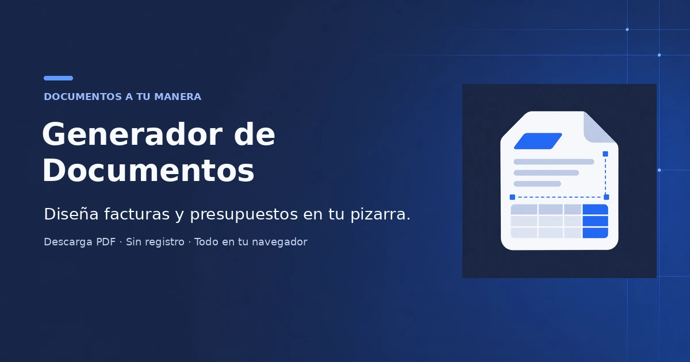

<div align="center">

<p align="center"></p>

# Generador de Documentos

**Diseña tu propia factura (y presupuestos, albaranes, recibos…) como en una pizarra, y descarga el PDF.**
Sin registro · Todo en tu navegador · Sin servicios de terceros

[**▶ Probarlo en vivo: djl.com.es/factura**](https://djl.com.es/factura/)


-informational>)

</div>

---

## Qué es

Un **motor de documentos visual tipo pizarra**. Colocas y editas cada pieza (título, logo, tabla de líneas,
totales, firma, pie…) donde quieras, eliges colores y tipografías, rellenas tus datos y los de tu cliente
y descargas un PDF vectorial. La **factura** fue el primer tipo; hoy hay 13 y se pueden añadir más sin
tocar el núcleo.

### Principios

- **Sin registro.** La identidad es tu navegador o tu archivo de diseño.
- **Privacidad total.** Todo se procesa en el navegador; ningún dato sale del dispositivo.
- **Sin servicios de terceros.** Ni CDN, ni Google Fonts, ni analítica: las fuentes se sirven en local.
- **Todo es editable.** Colores, tipografías, posiciones, papel, rejillas de tabla…
- **Diseño y datos separados.** El mismo diseño sirve como modelo limpio o relleno.
- **Archivo portable.** Un diseño se exporta e importa como un único archivo.

## Funcionalidades

| Área                    | Qué incluye                                                                                                                                            | Más                                                 |
| ----------------------- | ------------------------------------------------------------------------------------------------------------------------------------------------------ | --------------------------------------------------- |
| **Pizarra**             | Zoom, desplazamiento, selección múltiple, mover/redimensionar, imán y guías, alinear, capas, deshacer/rehacer ilimitado, atajos de teclado             | [lienzo](docs/lienzo.md)                            |
| **Piezas**              | Texto, imagen/logo, línea, formas, tabla de líneas elástica, totales, cabecera, pie con «Página X de N», código QR                                     | [piezas](docs/piezas.md)                            |
| **Estilos**             | Paleta de seis colores con nombre, colores enlazados, temas, bordes y cajas                                                                            | [estilos](docs/estilos.md)                          |
| **Fuentes**             | 31 familias locales (sin serifa, serifa, mono, titulares, manuscritas) con licencia OFL, carga bajo demanda y fuentes propias incrustables             | [fuentes](docs/fuentes.md)                          |
| **Papel**               | A3–A6, 80 mm de ticket, tamaños personalizados, orientación y márgenes; las piezas se adaptan                                                          | [papel](docs/papel.md)                              |
| **Páginas**             | Reparto automático en varias páginas, tabla partida por filas, piezas repetidas                                                                        | [páginas](docs/paginas.md)                          |
| **Tipos de documento**  | Factura, presupuesto, albarán, recibo, rectificativa, pedido, parte de trabajo, ticket, vale, carta de reclamación, hoja de encargo, etiqueta, tarjeta | [tipos](docs/tipos.md) · [factura](docs/factura.md) |
| **Factura**             | IVA por línea (21/10/4/0 %), IRPF, recargo de equivalencia, exenciones, series y numeración                                                            | [factura](docs/factura.md)                          |
| **Monedas**             | EUR, USD, GBP, CHF, CAD, AUD, MXN, ARS, COP, PEN y BRL por documento, importes en céntimos (sin errores de coma flotante)                              | [monedas](docs/monedas.md)                          |
| **PDF**                 | Vectorial directo (texto como contornos + capa de texto) o con la impresión del navegador                                                              | [pdf](docs/pdf.md)                                  |
| **Modo lote**           | Importa un CSV, asigna columnas y genera un ZIP con un PDF por documento (progreso y cancelación)                                                      | [lote](docs/lote.md)                                |
| **Galería y aleatorio** | Plantillas con miniatura por tipo y diseños al azar con datos ficticios                                                                                | [galería](docs/galeria.md)                          |
| **Archivos**            | Diseño `.diseno.json` (sin datos) y datos `.datos.json` por separado, plantilla y autoguardado en el navegador                                         | [archivos](docs/archivos.md)                        |
| **PWA**                 | Instalable y utilizable sin conexión (service worker generado al construir)                                                                            | [pwa](docs/pwa.md)                                  |
| **Móvil y tableta**     | Edición completa con el dedo: doble toque, pellizco, panel plegable, controles de 44 px y zonas seguras                                                | [móvil](docs/movil.md)                              |
| **Accesibilidad**       | Zonas ARIA, enlace de salto, avisos para lectores de pantalla, foco visible, movimiento reducido; auditoría axe-core sin errores                       | [accesibilidad](docs/accesibilidad.md)              |

## Tecnologías

| Capa           | Tecnología                                                                                |
| -------------- | ----------------------------------------------------------------------------------------- |
| Lenguaje       | **TypeScript 6** en modo estricto                                                         |
| Construcción   | **Vite 8** (base `/factura/`), plugin propio para el service worker                       |
| Interfaz       | **DOM + CSS** propios, sin framework de UI                                                |
| PDF            | **pdf-lib** + **@pdf-lib/fontkit** (contornos de glifos), motor propio en `src/pdf-file/` |
| QR             | **qrcode-generator**                                                                      |
| Fuentes        | **@fontsource/\*** (31 familias, woff2 latin y latin-ext) servidas en local               |
| Almacenamiento | **IndexedDB** y archivos exportados; sin cookies para guardar datos                       |
| ZIP            | Escritor propio (CRC32 + `CompressionStream`) para el modo lote                           |
| Calidad        | **Vitest 5** + happy-dom, **ESLint 10**, **Prettier 3**, **axe-core**                     |
| Despliegue     | Nginx estático con `scripts/deploy.sh`                                                    |

## Arquitectura

El proyecto es un **motor de documentos con núcleo cerrado**: el núcleo no sabe nada de facturas ni
albaranes. Cada tipo vive únicamente en `src/documents/<tipo>/` (definición, esquema, cálculos, textos,
plantillas) y se **descubre solo** (`import.meta.glob`), sin editar ningún registro.

> **Regla:** un tipo de documento nuevo nunca modifica el núcleo, solo añade su carpeta. Si necesita algo
> que el núcleo no ofrece, se amplía el núcleo en una iteración aparte y de forma genérica.

Para añadir un tipo, sigue [docs/anadir-tipo.md](docs/anadir-tipo.md).

```
src/
  core/        núcleo sin interfaz: geometría, unidades, documento y operaciones, historial, store, contrato de tipo
  canvas/      lienzo: editor, comandos, gestos, atajos, selección, imán, alinear, vista
  ui/          interfaz: barra, capas, propiedades, diálogos, accesibilidad y táctil
  app/         arranque: elige tipo y plantilla y crea el editor
  paper/       papeles: tamaños, orientación, márgenes, adaptación de piezas
  layout/      reparto en páginas: tabla elástica, partida por filas, piezas repetidas
  pieces/      piezas genéricas, una carpeta por pieza
  styles/      paleta, colores enlazados y temas
  fonts/       catálogo de fuentes locales y carga bajo demanda
  data/        importes en céntimos, monedas, variables y formato de datos
  images/      reglas y lectura de imágenes subidas
  pdf/         PDF con la impresión del navegador
  pdf-file/    PDF vectorial directo sin diálogo de impresión
  batch/       modo lote: CSV, asignación de columnas, ZIP y generación
  random/      modo aleatorio: datos ficticios y diseño al azar
  storage/     archivos de diseño y datos, almacenamiento local y autoguardado
  pwa/         instalación y uso sin conexión
  documents/   un tipo de documento por carpeta (lo único que crece al añadir tipos)
  main.ts      punto de entrada
docs/          documentación por función
scripts/       construcción de fuentes, aislamiento de tipos y despliegue
```

Las reglas del proyecto están en [CLAUDE.md](CLAUDE.md) y la hoja de ruta en [ROADMAP.md](ROADMAP.md).

## Desarrollo

Requiere **Node.js 22.13 o superior**.

```bash
npm install
npm run dev          # servidor de desarrollo
npm run check        # formato, lint, pruebas y build (hay que pasarlo antes de cada commit)
```

Otros comandos: `npm test`, `npm run lint`, `npm run format`, `npm run build`, `npm run preview`,
`npm run check:type` (comprueba que un tipo solo toca su carpeta).

## Despliegue

Sitio estático servido por Nginx bajo `/factura/`. Ver [docs/despliegue.md](docs/despliegue.md).

```bash
cd /opt/GeneradorFacturas && sudo ./scripts/deploy.sh
```

## Aviso legal

Esta herramienta sirve para diseñar documentos y generar PDF. **No es un sistema informático de
facturación con Verifactu** ni conserva registros inalterables. Revisa los requisitos aplicables con tu
gestoría.

## Estado y próximos pasos

Todas las fases de la versión 1 están hechas salvo **idiomas**. Después: **versión 2** (Verifactu y factura
electrónica entre empresas). Detalle en [ROADMAP.md](ROADMAP.md).

## Licencia

Pendiente de decidir.
